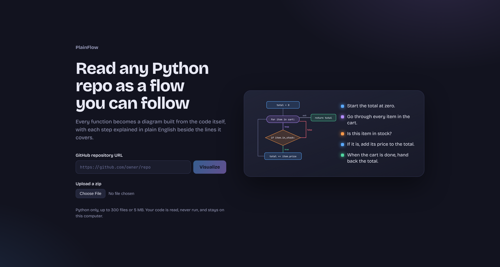
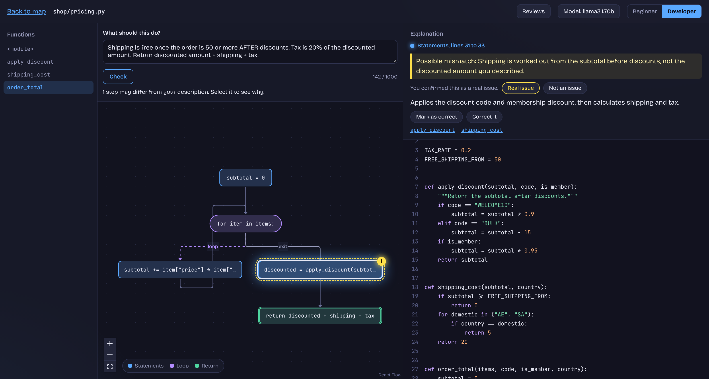
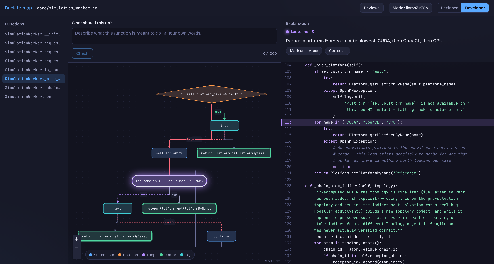
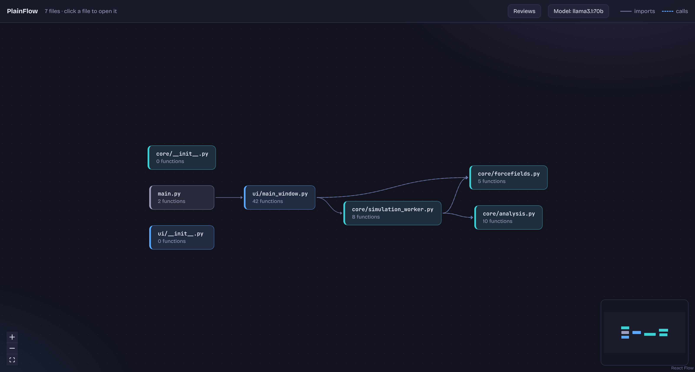

# PlainFlow

PlainFlow turns a Python repository into something you can read: a map of its files, a flow diagram of every function, and a plain-English explanation of each step, line or range of lines. It runs on your own computer.

## What it does

- **File map.** Every Python file, with arrows for imports and calls between files.
- **Flow diagrams.** Each function as a diagram of its steps: statements, branches, loops, returns, error handling. Click a box to highlight its lines; drag boxes to rearrange them.
- **Explanations.** Short, precise sentences for a step, a single line, a range of lines, or a whole function, in **Beginner** or **Developer** wording.
- **Intent check.** Describe what a function should do. PlainFlow flags the steps that appear to differ.
- **Your choice of model.** Paste an API key (Anthropic, OpenAI, Gemini, Groq, OpenRouter and others) or use a model on your own computer through Ollama or LM Studio.
- **Reviews and exports.** Mark explanations right or wrong, share reviews with teammates, and export them as training data or an onboarding guide.

## Privacy

- **PlainFlow runs locally.** Your code is read, never run.
- **Diagrams come from a parser, not from the AI.** Every box and arrow is derived from the code with Python's `ast`. The model only writes explanations for steps the parser found.
- **With an API key,** only the function you open is sent to the provider you chose, never the whole repo.
- **With a local model,** nothing leaves your computer.
- **Uploads and cached explanations are deleted after 24 hours.** Reviews you save are kept.

## Quick start

You need Python 3.11 or newer. Node is not needed to run the app.

```bash
git clone https://github.com/BioCoder007/PlainFlow.git
cd PlainFlow

# with conda
conda env create -f environment.yml
conda activate plainflow

# or with plain Python
python -m venv .venv
.venv/bin/pip install -r requirements.txt      # Windows: .venv\Scripts\pip install -r requirements.txt

python main.py
```

PlainFlow opens at <http://localhost:8000>. Then:

1. Upload a zip of a Python repo, or paste a public GitHub URL.
2. Click a file on the map to open it.
3. Pick a function on the left to see its flow diagram.
4. Click **Choose AI model** in the top bar and paste an API key (see [Choosing an AI model](#choosing-an-ai-model)). The map and diagrams work without one.
5. Click a step, a line, or drag across lines to get an explanation.

Options: `python main.py --port 9000`, `--no-browser`, `--host 0.0.0.0` (see [Working as a team](#working-as-a-team)).

## Screenshots

The explanations in these screenshots come from a scripted stand-in model, not a live one, so they show the interface, not the quality of any real model's output. The diagrams, maps and code panes are real output from the parser. The screenshots are from an earlier build: the current app has brighter diagram colours and a few more buttons.



**Intent check** on a small demo repo. The developer describes what the code should do, and the step that appears to differ is flagged.



**On a real project.** [Jiggle](https://github.com/BioCoder007/JIGGLE) is a live molecular-dynamics viewer (7 Python files). Here is how it picks an OpenMM platform. The explanation text was written by hand from reading the code.





## Using it

- **Click a step in the flow** to explain the whole step.
- **Click any line of code** to explain only that line. Use **Previous line** and **Next line** to walk through a function line by line. The step the line belongs to is shown underneath.
- **Drag across lines** (or shift-click a second line) to select a range. The code scrolls when you hold the pointer near the top or bottom edge. The range is explained as one piece of logic: the order of operations and how values flow between the lines.
- **Drag any box in a diagram** to move it. **Reset layout** puts the boxes back.
- **Explain whole function** explains the full logic of the function in one answer.
- Long functions are sent to the model in small parts, so free tiers with low per-request limits (such as Groq's) still work.
- Explanations use ASD-STE100 Simplified Technical English: short sentences, one fact each, exact names from the code. They state the logic (values, tests, results, side effects), not a general summary.
- **Beginner** names each construct in plain words. **Developer** skips basics and adds types, mutation and error paths where they matter.
- Quality depends on the model. Small models (for example "lite" or very small local models) give vaguer answers; a larger model gives more precise ones.

## Choosing an AI model

PlainFlow uses an AI model to write the plain-English explanations and to run the intent check. The map and the flow diagrams work without one.

**New to this? Start here.** An *API key* is a long secret password that lets PlainFlow talk to an AI service on your behalf. You make one on the provider's website, copy it, and paste it into PlainFlow. That's the whole setup.

| I want... | Pick | Cost |
| --- | --- | --- |
| The quickest free start | **Google Gemini** | Free tier with limits (check Google's page) |
| Nothing to leave my computer | **Ollama** or **LM Studio** (local) | Free, but needs a decent computer |
| The best explanations | **Anthropic (Claude)** or **OpenAI** | Pay as you go |
| Many models behind one key | **OpenRouter** | Pay as you go |

### Quick steps for every provider

1. Start PlainFlow (`python main.py`), open a repo, and click **Choose AI model** in the top bar.
2. Paste your API key. That is the only field you need. PlainFlow recognises the provider from the key, finds its address, lists the models the key can use, and fills in a fast one.
3. Pick a different model from the list if you like, or type a name.
4. Click **Test connection**. When it says "Connection works", click **Save**.

Other ways to set up:

- **Find my provider** appears when PlainFlow does not recognise the key. It tries the key with OpenAI, Anthropic, Gemini, Groq, Mistral, DeepSeek, Together, xAI, Cerebras and Fireworks and uses the one that accepts it. PlainFlow only does this when you click the button, because it sends the key to each of those services.
- **Use a model on this computer (no key)** looks for Ollama or LM Studio and lists the models you have installed. The address field and the **Ollama** and **LM Studio** shortcuts appear too, so you can point PlainFlow at your model server yourself, including one on another port or another machine on your network.
- **Set up manually** shows the provider and endpoint address fields, for any other OpenAI-compatible service or a custom address.

Your settings stay in your browser. The key is passed to your chosen provider and is never stored or logged by PlainFlow.

### Google Gemini (free tier)

1. Go to <https://aistudio.google.com/apikey> and sign in with a Google account.
2. Click **Create API key** and copy it. New keys start with `AQ.` and older ones with `AIza`. Both work in PlainFlow.
3. Paste it into PlainFlow and pick a model such as a *flash* one.
4. Free tiers have rate limits. If you see "rate-limiting", wait a minute and try again.

### Anthropic (Claude)

1. Go to <https://console.anthropic.com>, sign in, and open **API Keys**.
2. Click **Create Key** and copy it. It starts with `sk-ant-`. You may need to add credit first under billing.
3. Paste it into PlainFlow. A *Haiku* model is cheapest and fastest; a *Sonnet* model explains more carefully.

### OpenAI

1. Go to <https://platform.openai.com/api-keys> and sign in.
2. Click **Create new secret key** and copy it. It starts with `sk-`. You may need to add credit first under billing.
3. Paste it into PlainFlow and pick a model from the list. A *mini* model is the cheap choice.

### OpenRouter (one key, many models)

1. Go to <https://openrouter.ai/keys> and create a key. It starts with `sk-or-`.
2. Paste it into PlainFlow. The address is filled in for you (`https://openrouter.ai/api/v1`). Some models on OpenRouter are free.

### Groq

1. Go to <https://console.groq.com/keys> and create a key. It starts with `gsk_`.
2. Paste it into PlainFlow. The address is filled in for you (`https://api.groq.com/openai/v1`).

### A model on your own computer (fully private, no key)

With a local model, your code never leaves your machine.

**Ollama**
1. Install it from <https://ollama.com>.
2. Open a terminal and download a model: `ollama pull <model-name>`. Pick one that fits your computer; smaller models need less memory. Browse names at <https://ollama.com/library>.
3. In PlainFlow click **Choose AI model**, then **Use a model on this computer (no key)**. PlainFlow finds Ollama and lists your downloaded models. If it does not, click the **Ollama** shortcut.

**LM Studio**
1. Install it from <https://lmstudio.ai> and download a model inside the app. LM Studio models are GGUF files.
2. Open its **Developer** tab and start the local server.
3. In PlainFlow click **Choose AI model**, then **Use a model on this computer (no key)**. If LM Studio is not found, click the **LM Studio** shortcut.
4. Pick your model from the list, click **Test connection**, then **Save**.

PlainFlow connects to the running server. It does not load a GGUF file directly.

Small local models sometimes return replies PlainFlow can't read. If steps say "No explanation available", try a larger model.

### Any other OpenAI-compatible service

Click **Set up manually**, choose **Other**, enter the service's address (it usually ends in `/v1`), paste the key if it needs one, and pick or type a model.

### If something goes wrong

| Message | What to check |
| --- | --- |
| "API key was rejected" | The key was copied in full, with no spaces, and has not been deleted. |
| "rejected the request (400)" | The key is wrong (Gemini says 400 for a bad key) or the model name is wrong. Pick one from the list. |
| "too large for the model's request limit (413)" | The function is bigger than the model's per-request limit. This is common on Groq's free tier. Open a shorter function or use Gemini Flash. |
| "did not reply in the required format" | The model answered in a form PlainFlow could not read. Small models do this often. Click Retry, or choose a larger model. |
| "did not recognise the model" | The model name or address is wrong. Pick from the list. |
| "rate-limiting ... or out of credit" | Wait a minute, or add credit on the provider's billing page. |
| "could not be reached" | Check your internet. For a local model, check that Ollama or LM Studio is running. |

Keep keys private. Never put one in a file you share or commit to GitHub, and delete a key on the provider's site if it leaks.

## Reviews and exports

When a developer reads an explanation they can **Mark as correct** or **Correct it**. When the intent check flags a step they can mark it **Real issue** or **Not an issue**. Each verdict is saved on this machine in `data/reviews.sqlite`, together with the code it is about.

- Reviews are kept until you delete that file. Unlike uploaded code, they are not removed after 24 hours.
- A review follows the code: upload the same repo again and the reviews of unchanged functions are still there.
- Reviewing a step again replaces the earlier verdict.

The **Export** button offers three downloads, all built only from reviewed items:

| Export | What it is for |
| --- | --- |
| Training data, full records (JSONL) | One line per review: file, function source, the step and its code, the model's text, which model wrote it, the verdict and the final text. For evaluating models or building your own formats. |
| Training data, chat format (JSONL) | One fine-tuning example per review in system / user / assistant form. The assistant turn is the approved or corrected explanation, or the human verdict on a mismatch. |
| Onboarding guide (Markdown) | A walkthrough of this repo's reviewed functions: the code, the approved explanation of each reviewed step, and confirmed issues. |

The exports contain your source code. API keys are never written to them.

### Working as a team

Open **Reviews** in the top bar and enter your name. It is saved with every review you make.

There are two ways to share reviews:

| Way | How | Good for |
| --- | --- | --- |
| Exchange files | Each person downloads "Training data, full records" and sends it to the others, who use **Import a teammate's reviews**. | Teams where everyone runs the app on their own machine. Nothing to host. |
| One shared instance | Run the app once on a machine the team can reach; everyone opens it in a browser. All reviews land in one place. | Teams on one network. |

How merging works when you import a file:

- A review you did not have is added.
- Where both sides reviewed the same step, the newer verdict is kept.
- If two people reached different verdicts on a step, the import tells you how many such cases there were.
- Importing the same file twice changes nothing. Damaged lines are skipped and counted.

To run one shared instance, start PlainFlow so other machines can reach it:

```bash
python main.py --host 0.0.0.0 --no-browser
```

Teammates then open `http://<that machine's address>:8000`.

On a shared instance, each person's API key passes through that machine on its way to the provider, and a "local model" address means a model reachable from that machine, not from the person's laptop. There is no login: anyone who can reach the address can use it, so keep it on a private network.

## Limits

- Python only.
- Up to 3000 Python files or 50 MB of Python source per repo; zips up to 250 MB.
- GitHub URLs work for public repositories only. Upload a zip for private code.
- A call is linked only when it can be resolved by reading the code: a function in the same file, a function imported by name, `module.function()` through an import, or `self.method()` in the same class. Everything else is shown as unresolved.
- Explanation quality depends on the model. Small models give vaguer answers and sometimes reply in a format the intent check and step explanations cannot read.
- Free API tiers can hit rate limits on large functions.
- A selected range of lines must fit in one request (about 12,000 characters). For a large file, **Explain whole function** on `<module>` asks you to select fewer lines.
- Line and range explanations cannot be reviewed or exported yet; reviews work per step.
- Local models are reached through a running server (Ollama, LM Studio or any OpenAI-compatible one). PlainFlow does not load model files itself.
- Diagram boxes you move are not saved between sessions.
- There is no login. Keep a shared instance on a private network.

## What has and has not been tested

- The engine, server and web test suites pass, and the main screens were checked in headless Chrome.
- Provider calls in the tests use fake providers. The build environment could not reach Anthropic, OpenAI, Google, Groq, Ollama or LM Studio, so each provider path has only been exercised by real use, not by the test suite.
- GitHub URL ingest is covered by tests with a fake GitHub, not against the real API.
- No repo near the 3000-file limit has been tried.

Please open an issue if something fails, with the message PlainFlow showed (never include your API key).

## For developers

### Layout

| Folder | What it is |
| --- | --- |
| `main.py` | Starts the app: the API and the built web app on one port. |
| `engine/` | `cve_engine`, a standalone Python package: repo → model, explanations, intent check. No web dependencies. |
| `server/` | FastAPI app that ingests a GitHub URL or zip and exposes the engine over HTTP. `server/app/static/` holds the built web app. |
| `web/` | React app (source): start page, repo map, linked file view. |
| `docs/screenshots/` | Images used in this README. |

### Changing the web app

Needs Node 20+ (included in the conda environment).

```bash
cd web && npm install
npm run dev          # hot reload on http://localhost:5173, with `python main.py` running for the API
npm run build -- --outDir ../server/app/static --emptyOutDir    # rebuild the bundled web app
```

### Tests

```bash
cd engine && python -m pytest -q
cd server && python -m pytest -q
cd web && npm test
```

### Environment variables

| Variable | Used by | Default | Purpose |
| --- | --- | --- | --- |
| `CVE_PROVIDER`, `CVE_MODEL`, `CVE_API_KEY`, `CVE_BASE_URL` | server | none | Optional default model for requests that name none (`CVE_PROVIDER` defaults to `anthropic`) |
| `CVE_DATA_DIR` | server | `./data` | Session folders, the explanation cache and reviews |
| `CVE_WEB_ORIGIN` | server | `http://localhost:5173` | Extra origin allowed by CORS (only needed with `npm run dev`) |
| `VITE_API_URL` | web | same address as the page; `http://localhost:8000` under `npm run dev` | Where the web app finds the API |

### Using the engine on its own

```python
from pathlib import Path
from cve_engine import build_repo_model

model = build_repo_model(Path("path/to/repo"))
print(model.to_dict())
```

## License

MIT. See [LICENSE](LICENSE).
